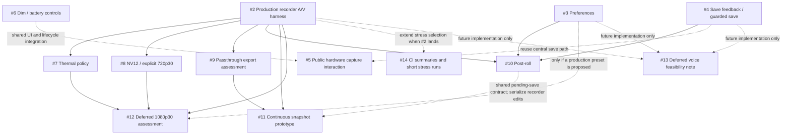

# Open issue dependency graph and parallel execution

Reviewed against `esdu/app2` main commit `a9a396118bb1dba673238a90772397ad955beb0d`.
Scope: open app2 child issues #2–#14; #15 is the handoff/rollup tracker. App1 links provide reference implementations, not additional app2 prerequisites. Privacy issue #1 is already resolved and its source, built-app, and unsigned archive validation remains mandatory.

## Dependency graph

Solid arrows are implementation/correctness gates. Dotted arrows are integration contracts or requirements for a future implementation; research can start before those gates are met.

#2 is the correctness gate for recorder/media behavior changes. #9 can develop its exporter adapter alongside the harness, but its correctness decision waits for real segment output and decoded endpoint checks. #7 and #8 can proceed concurrently after #2 if thermal work stays in the model/monitor layer and format work owns the capture configuration layer.

#10 and #11 do not form a cycle: agree on fixed media-time interval/pinning semantics first, implement bounded post-roll on the existing recorder, then evaluate the continuous snapshot prototype against that contract. A complete fMP4 rewrite is not required for post-roll. The production default remains the existing recorder unless comparative correctness and device evidence justify replacement.

The #13 feasibility note has no hard code dependency. Its references to #2/#3/#4 constrain a later implementation. The user explicitly scheduled the outstanding assessments, so the note can be written now while production voice stays disabled. For #12, desktop budget/capability research can proceed early, but the final device assessment and any production preset wait for the stated foundations and physical measurements.

## File ownership and merge constraints

Work that shares a file is isolated in a worktree; conceptual independence does not authorize competing writes into the same checkout.

| Issue | Implementation gate | Shared-file / merge constraint |
| --- | --- | --- |
| #2 | None | Owns recorder extraction, ingestion seam, SegmentWriter, recorder tests |
| #3 | None | Preferences/model/app initialization; integrate before persistent feature options |
| #4 | None | Model save outcomes and global feedback; integrate after preferences to reconcile shared model/view files |
| #5 | None for adapter | Integrate on the shared guarded save path from #4; iOS 17.2 gate with iOS 17 fallback |
| #6 | None | Independent screen/battery adapters; merge view changes after #3/#4 and coordinate dim save with #5 |
| #7 | #2 | Model/thermal policy, after prior model/lifecycle changes; no competing recorder rewrite |
| #8 | #2 | Owns capture format selection and format fixtures; coordinate recorder/SegmentWriter changes |
| #9 | #2 correctness gate | Owns composer/export policy and endpoint validation; default requires measured correctness benefit |
| #10 | #2, #3, #4 | Owns pending-save/interval collection after shared API agreement; serialize recorder/model integration |
| #11 | #2, #9 | Opt-in prototype and decision note; coordinate against #10's interval contract; keep production default unchanged without evidence |
| #12 | #2, #7, #8; stable recorder for profiling | Assessment, no production 1080p/4K/60 fps defaults; preference store required for any later option |
| #13 | Explicit assessment scheduling (satisfied) | Documentation/isolated assessment only; future code uses #2/#3/#4 |
| #14 | None for diagnostics | CI/scripts only; consume short #2 cases after their names/API stabilize |
| #15 | All child results | This graph, integration status, links to focused PRs and verification evidence |

## Initial maximum-parallel allocation

There are seven total agent slots: the coordinator plus six sub-agents. The initial wave fills all slots.

| Worker | Initial assignment | Isolated worktree |
| --- | --- | --- |
| recorder_harness | #2 | `/workspace/work/app2-worktrees/recorder` |
| preferences | #3 | `/workspace/work/app2-worktrees/preferences` |
| save_feedback | #4 | `/workspace/work/app2-worktrees/feedback` |
| dim_battery | #6 | `/workspace/work/app2-worktrees/dim` |
| ci_diagnostics | #14 | `/workspace/work/app2-worktrees/ci` |
| voice_assessment | #13 | `/workspace/work/app2-worktrees/voice` |
| Coordinator | #5, graph, reviews/integration/CI | `/workspace/work/app2-worktrees/volume`, integration checkout |

As workers finish, reuse their slots for #7/#8/#9 after the harness, then #10/#11 and the #12 assessment when their gates allow. Research, test design, and interface proposals may proceed early; dependent production edits wait for the gate. Each child keeps a focused branch/PR. Shared model/view integration is sequenced preferences → feedback → dim/input → thermal → post-roll. Recorder integration is sequenced harness → format → pending saves; exporter work uses a separate file lane.

## Verification and completion rules

- Preserve explicit start/restart, stopped launch, foreground-only capture, file protection/backup exclusion, local atomic publication, source leases, bounded work/storage, per-stream timing, low-disk stops, and the watchdog.
- Run meaningful affected tests and the required macOS simulator CI; retain ordinary, stress, privacy, and unsigned archive artifacts. A failed iteration remains a failure, not a retry success.
- Keep hardware, brightness, haptic, thermal, energy, speech, real camera cadence/orientation, and signed App Store checks marked pending until actually executed on the required device/team.
- Assessment deliverables can conclude defer/no-go. Do not enable production voice, expanded quality, passthrough defaults, or a replacement recorder merely to close an issue.
- Close an issue only against its completed scope and observed evidence. Record partial implementations or physical-evidence blockers explicitly.
